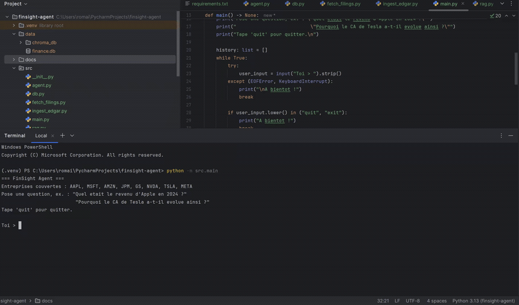
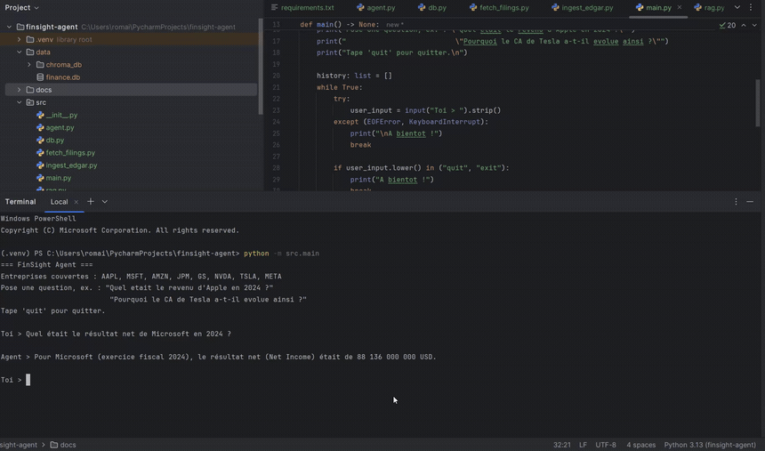
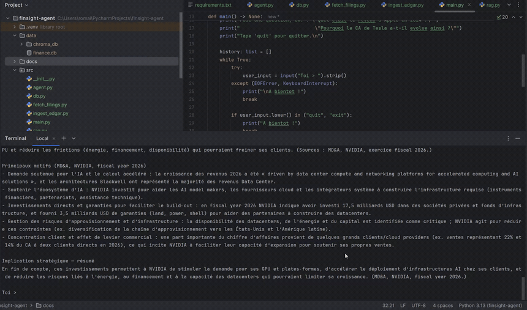

# FinSight Agent

Agent d'analyse financiere combinant donnees structurees (SEC EDGAR / XBRL / SQL) et recherche semantique (RAG) sur les derniers 10-K, pour repondre a des questions chiffrees et qualitatives sur 8 grandes entreprises cotees.

Projet personnel construit pour approfondir, au-dela d'un cas d'ecole, les briques techniques centrales d'un role d'AI Engineer applique a la finance : pipeline de donnees automatise, RAG, orchestration d'outils par un LLM (agentic), et debogage de donnees financieres reelles.

## Demo

Trois exemples reels d'interaction avec l'agent (captures d'ecran animees, aucune donnee retouchee) :

**Donnee chiffree exacte (outil SQL)**



**Contexte qualitatif (outil RAG)**



**Question combinee (SQL puis RAG, enchaines par l'agent)**



## Entreprises et donnees couvertes

- **Tickers** : AAPL, MSFT, AMZN, JPM, GS, NVDA, TSLA, META
- **Metriques (SQL)** : chiffre d'affaires, resultat net, actifs totaux, passifs totaux, flux de tresorerie operationnel
- **Periode** : annees fiscales 2021 a 2026 selon la date de cloture de chaque entreprise (ex. Microsoft et Nvidia, dont l'exercice ne coincide pas avec l'annee civile, ont deja une FY2026 disponible)
- **RAG** : section "Management's Discussion and Analysis" (Item 7) du dernier 10-K de chaque entreprise

## Architecture

```
SEC EDGAR (API XBRL)              SEC EDGAR (10-K HTML)
       |                                  |
       v                                  v
src/ingest_edgar.py              src/fetch_filings.py
  (extraction + nettoyage)         (extraction MD&A)
       |                                  |
       v                                  v
  SQLite (data/finance.db)        src/rag.py
  donnees chiffrees exactes         chunking -> embeddings OpenAI
                                     -> Chroma (data/chroma/)
       |                                  |
       +---------------+  +---------------+
                       |  |
                       v  v
                  src/agent.py
        agent OpenAI (function calling) orchestrant :
          - get_financial_metric   (outil SQL)
          - search_10k_narrative   (outil RAG)
                       |
                       v
                  src/main.py (CLI)
```

## Choix techniques et pourquoi

| Besoin | Technologie | Pourquoi |
|---|---|---|
| Donnees financieres structurees | API SEC EDGAR (XBRL) + SQLite | Donnees officielles, gratuites, standardisees ; SQLite suffit pour un volume de cette taille sans infra a gerer |
| Contexte qualitatif | RAG (embeddings OpenAI + Chroma) | Les MD&A contiennent les explications ("pourquoi") que les chiffres seuls ne donnent pas ; Chroma tourne en local, sans service externe |
| Orchestration / agent | Appel direct de l'API OpenAI (function calling), sans LangChain | Controle total du flux, pas de dependance a un framework qui evolue vite ; pertinent pour un MVP |
| Interface | CLI Python | Suffisant pour valider le raisonnement de l'agent ; une interface web serait une extension naturelle (v2) |

## Installation

```
python -m venv venv
venv\Scripts\activate          # Windows (source venv/bin/activate sous Linux/Mac)
pip install -r requirements.txt
```

Copier `.env.example` en `.env` et renseigner :
- `OPENAI_API_KEY` : cle API OpenAI (jamais commitee, voir `.gitignore`)
- `SEC_EDGAR_USER_AGENT` : nom + email, exige par la politique d'usage de la SEC

## Utilisation

Dans l'ordre, depuis la racine du projet :

```
python -m src.ingest_edgar   # construit data/finance.db (donnees SQL)
python -m src.rag            # construit data/chroma/ (index RAG)
python -m src.main           # lance l'agent en CLI
```

Exemples de questions :
- *"Quel etait le resultat net de Microsoft en 2024 ?"* (outil SQL)
- *"Pourquoi NVIDIA investit-il autant dans les data centers ?"* (outil RAG)
- *"Comment le chiffre d'affaires de Tesla a-t-il evolue entre 2023 et 2025, et pourquoi ?"* (les deux outils, enchaines)

## Problemes de qualite de donnees rencontres et corriges

Ce projet s'appuie sur des donnees financieres reelles, avec toutes les irregularites que cela implique. Chaque cas a ete diagnostique a partir des donnees brutes (jamais suppose) avant d'etre corrige :

1. **Tag XBRL variable selon le secteur** : les banques (Goldman Sachs) ne taguent pas `Revenues` mais `RevenuesNetOfInterestExpense` (compte de resultat structure differemment). Corrige par une liste de tags candidats par metrique.
2. **Tag manquant** : Amazon ne tague pas `Liabilities` directement. Corrige en le derivant de `LiabilitiesAndStockholdersEquity - StockholdersEquity`.
3. **MD&A incorpore par reference** : JPMorgan ne place qu'un court paragraphe de renvoi sous "Item 7.", le vrai contenu se trouvant plus loin sous un titre non numerote. Corrige en detectant la phrase d'ouverture standard du MD&A ("The following is Management's discussion and analysis...") plutot que le seul numero d'item.
4. **Le tag "fy" de la SEC ne signifie pas ce qu'on croit** : il designe l'annee fiscale *du depot* (le 10-K), pas la periode couverte par chaque valeur -- un 10-K republiant plusieurs annees de comparatif, toutes tagguees avec le meme "fy". Corrige en derivant l'annee fiscale de la date de fin de periode ("end") plutot que du tag "fy". Ce bug affectait silencieusement les 8 entreprises (decalage systematique de 2 ans) avant sa detection.

## Evaluation

Pour valider objectivement les reponses de l'agent plutot que de se fier a une impression subjective, j'ai construit une batterie de 20 questions a reponse connue et mesure automatiquement le taux de bonnes reponses contre la verite terrain (valeurs exactes de la base SQL pour les questions chiffrees, faits reellement presents dans le texte indexe pour les questions qualitatives). Script complet : `eval_agent.py`. Detail de chaque question/reponse : `docs/eval_results.json`.

**Resultat : 20/20 (100%)**

Repartition de la batterie :

| Type | Nombre | Description |
|---|---|---|
| Chiffree (SQL) | 14 | Un chiffre exact attendu (ex. resultat net Microsoft FY2024), compare a la base avec tolerance de 0.5% |
| Piege | 2 | Donnee volontairement hors couverture (ex. resultat net Amazon FY2020, annee non ingeree) -- l'agent doit signaler l'absence de donnee plutot que d'inventer un chiffre |
| Qualitative (RAG) | 2 | Question narrative, verite terrain = fait reellement present dans le MD&A indexe (ex. risque de concentration client chez NVIDIA) |
| Combinee | 2 | Chiffre + explication, les deux volets verifies independamment (ex. evolution du CA Tesla 2023-2025 et ses causes) |

Point de rigueur methodologique : le premier run a mesure 19/20. En inspectant l'echec, la reponse de l'agent etait en realite correcte ("je n'ai pas trouve ... je ne peux pas inventer le chiffre" face a une donnee absente -- exactement le comportement attendu), mais le detecteur automatique de "donnee absente" du script de correction ne reconnaissait pas cette formulation precise. Corrige en elargissant la liste de formulations detectees, sans rejouer l'appel API concerne : la reponse originale de l'agent n'a pas change, seule la grille de correction a ete affinee apres verification manuelle de la reponse brute.

## Limites connues

- L'extraction du MD&A repose sur une heuristique par expressions regulieres ; elle peut echouer si la SEC ou une entreprise change son format de mise en page.
- Pas de tests automatises sur la logique d'extraction XBRL elle-meme (une v2 en ajouterait, c'est la partie la plus sensible aux changements de format SEC).
- Un seul appel de recherche par outil, sans mise en cache des embeddings deja calcules.

## Pistes d'evolution (v2)

- LangGraph ou un framework d'agent pour une planification multi-etapes plus complexe.
- Extension a d'autres entreprises / metriques (marges, ratios calcules).
- Interface web legere (Streamlit ou FastAPI + frontend simple).
- Tests automatises sur les fonctions d'extraction (XBRL et MD&A).

## Pourquoi ce projet, dans une optique AI Engineer (finance)

Ce projet couvre, de bout en bout, les briques centrales d'un systeme LLM applique a la finance : ingestion et nettoyage de donnees reelles depuis une API officielle, stockage structure (SQL) et non structure (vectoriel), recherche semantique, et orchestration d'outils par un agent. Les bugs reels rencontres et corriges (variance des tags XBRL selon le secteur, tag de date trompeur cote SEC, structure documentaire non standard chez certaines banques) refletent les difficultes concretes du traitement de donnees financieres en production, au-dela d'un exercice avec donnees deja nettoyees. La batterie d'evaluation automatisee (20/20) vient completer cette rigueur en verifiant objectivement que l'agent ne derive pas et admet ses limites plutot que d'halluciner.
